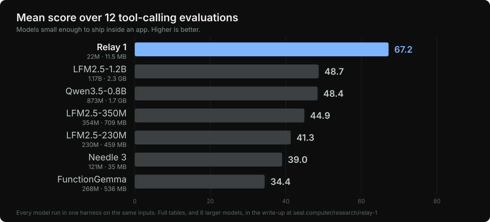

**[Write-up](https://seal.computer/research/relay-1)** • **[Try it in your browser](https://seal.computer/research/relay-1#try-it)** • **[Code](https://github.com/sealresearch/gust)** • **[Seal](https://seal.computer)**

Relay 1 turns what a person said and the tools an app offers into the calls to make, or into no call when nothing fits.
It runs on the device: natively on x86-64 and ARM64, and in a browser tab through WebAssembly, with no GPU, no server
and no Python in the path.

- **Small**: 22 million parameters in 11.5 MB of model files, 4-bit weights throughout.
- **Fast**: about 39 ms per request on 8 threads in WebAssembly, and a median under 80 ms on every benchmark we run.
- **Exact**: Relay does not write its calls one token at a time. It reads the request and the tool schemas together,
  then points at the answer, so it cannot invent a value that is not in the request, and it is unusually good at filling
  slots. That is also where its limits come from, and they are listed below.

```
User   Set an alarm for 6:45 tomorrow, then text Sam I'm running late
Tools  set_alarm(time, label?), send_message(recipient, body), get_weather(city), ...

Relay  set_alarm(time="2026-10-18T06:45:00")
       send_message(recipient="Sam", body="I'm running late")
```

Relay is built by [Seal Research](https://seal.computer). The write-up has the method, the full benchmark tables and the
failure cases: **[Relay 1: a tool-calling model that reads instead of writes](https://seal.computer/research/relay-1)**.

## Model details

| Property | Value |
|---|---|
| Developer | Seal Research |
| Model type | Encoder with routing, anchor and argument heads; outputs are value programs over the request text |
| Parameters | 21.8M (12.5M encoder, 6.1M embeddings, 3.1M heads) |
| Size | 11.47 MB of model files with 4-bit weights; 14.0 MB with the tokenizer and the retrieval prefilter |
| Vocabulary | 16k tokens, pruned from 50k |
| Language | English (evaluated on English benchmarks only) |
| Runtime | [Gust](https://github.com/sealresearch/gust), Seal's dependency-free C runtime |
| Release date | October 2026 |
| Licence | CC BY 4.0 |

### Files

| File | What it is | Size |
|---|---|---|
| `relay.gust` | the encoder | 9.9 MB |
| `relay-route.gust` | the router head: which tools to call | 0.08 MB |
| `relay-anchor.gust` | the anchor head: where each call's values come from | 0.05 MB |
| `relay-args.gust` | the argument head | 1.5 MB |
| `relay-tokenizer.json` | the tokenizer | 0.5 MB |
| `relay-prefilter.bin` | optional retrieval prefilter for long tool lists | 2.1 MB |
| `SHA256SUMS` | checksums of the files above | |

The `.gust` files are quantized graphs for the Gust runtime. They are not PyTorch or safetensors files, and they do not
load in `transformers`.

## Get started

With the [`sealpup` command line](https://github.com/sealresearch/gust/tree/main/cli), which downloads Relay and the
program that runs it, and checks both:

```sh
sealpup install relay-1
sealpup run relay-1 "Show me the Eiffel Tower on the map"
```

```
  ✓ show_map
      query  "Eiffel Tower"  copied     100%
```

`sealpup run` offers a built-in set of phone tools; `--tools tools.json` gives it your own.

Or build the host from the [Gust repository](https://github.com/sealresearch/gust) yourself. You need
[zig](https://ziglang.org).

```sh
git clone https://huggingface.co/sealresearch/relay relay-model
git clone https://github.com/sealresearch/gust && cd gust
ZIG=/path/to/zig ./build.sh x64

out/relay-x64.exe ../relay-model --record '{
  "text": "Show me the Eiffel Tower on the map",
  "tools": [
    {"name": "show_map", "description": "Shows a location on the map.",
     "params": [{"name": "query", "type": "string", "description": "The place to show.", "required": true}]},
    {"name": "turn_on_flashlight", "description": "Turns the flashlight on.", "params": []}
  ]
}'
# [{"tool": "show_map", "args": {"query": "Eiffel Tower"}}]
```

In Node or a browser, run `npm install @sealresearch/relay` and call `Relay.load()`, which downloads and checks these files for you
([package](https://github.com/sealresearch/gust/tree/main/packages/relay)). To build the WebAssembly runtime yourself, run `./build.sh wasm`
and use `models/relay/web/relay-native.mjs`. The native and WebAssembly builds return the same calls, byte for byte, for any thread count.

### The request

An app gives Relay a record: the message, the tools it offers, and the date. Relay returns `[{tool, args}]`, or `[]` when no
tool fits.

```json
{
  "text": "Set an alarm for 6:45 tomorrow",
  "tools": [
    {"name": "set_alarm", "description": "Sets an alarm.",
     "params": [{"name": "time", "type": "string", "description": "When it rings, as an ISO 8601 time.", "required": true}]},
    {"name": "turn_on_flashlight", "description": "Turns the flashlight on.", "params": []}
  ],
  "context": {"now": "2026-10-23T09:00:00"}
}
```

A tool is `{name, description, params}`, and a parameter is `{name, type, description, required, enum}`, with `type` one of
`string` (the default), `integer`, `number`, `boolean`, `array` or `object`, and `default`, `items` and `properties` for the
rest. Pass `context.now`: without it, a request that needs a date ("tomorrow") gets no call. Tools written as JSON Schema,
the way OpenAI (`parameters`), Anthropic (`input_schema`) and MCP (`inputSchema`) describe them, are not this format: Relay
reads them as tools without parameters and makes no call, so convert them first. Every field and a short converter in
JavaScript and Python are in the [request reference](https://github.com/sealresearch/gust/blob/main/models/relay/TOOLS.md).

## Evaluation

We ran Relay 1 and 12 other models on 12 evaluations, in one harness and on the same inputs, and report all of them,
including the ones Relay loses. Each model used its own chat template and its own native tool-call format.



Models small enough to ship inside an app. Exact-match accuracy; the best on-device score in each column is in bold.

| Model | Parameters | Size | Mean (12) | Mobile Actions | DroidCall | BFCL | SNIPS | ToolACE | NexusRaven | Sealed set |
|---|---:|---:|---:|---:|---:|---:|---:|---:|---:|---:|
| **Relay 1** | 22M | 11.5 MB | **67.2** | **92.2** | 44.5 | 63.9 | **93.3** | 44.3 | 37.4 | **83.6** |
| LFM2.5-1.2B | 1.17B | 2.3 GB | 48.7 | 81.6 | 36.0 | **68.4** | 27.2 | 53.7 | 32.1 | 81.0 |
| Qwen3.5-0.8B | 873M | 1.7 GB | 48.4 | 73.7 | 26.5 | 64.5 | 30.6 | **53.9** | **45.3** | 71.1 |
| LFM2.5-350M | 354M | 709 MB | 44.9 | 77.0 | 38.0 | 63.9 | 20.9 | 53.8 | 33.6 | 74.0 |
| LFM2.5-230M | 230M | 459 MB | 41.3 | 70.6 | 29.0 | 62.7 | 15.0 | 47.4 | 36.5 | 69.6 |
| Needle 3 | 121M | 35 MB | 39.0 | 87.5 | **45.5** | 51.8 | 14.9 | 37.5 | 17.3 | 67.1 |
| FunctionGemma | 268M | 536 MB | 34.4 | 59.3 | 20.5 | 49.0 | 18.1 | 46.7 | 23.0 | 57.5 |

For scale, three of the larger models we ran:

| Model | Parameters | Size | Mean (12) | Mobile Actions | DroidCall | BFCL | SNIPS | ToolACE | NexusRaven | Sealed set |
|---|---:|---:|---:|---:|---:|---:|---:|---:|---:|---:|
| Qwen3.5-4B | 4.7B | 9.3 GB | 67.1 | 92.2 | 56.0 | 80.0 | 51.0 | 69.1 | 65.1 | 89.8 |
| Qwen3.6-35B-A3B | 35B (3B active) | 72 GB | 70.7 | 89.8 | 54.5 | 80.4 | 56.4 | 67.7 | 68.9 | 89.1 |
| DeepSeek V4.1 Flash | 748B | 510 GB | 70.4 | 81.5 | 55.0 | 79.1 | 66.8 | 69.0 | 61.6 | 88.9 |

- Relay is tied for first of all 13 models on Mobile Actions, and first on both SNIPS slot-filling sets, against models
  of up to 748B parameters.
- It loses on general tool calling over arbitrary schemas: on BFCL, ToolACE and NexusRaven, language models from 2B
  parameters up are well ahead.
- The table shows 7 of the 12 evaluations. The rest (DSTC8, SNIPS 7-way, Glaive, BitAgent, ATIS), the other larger
  models, and how each benchmark was scored are in the [write-up](https://seal.computer/research/relay-1).
- The Sealed set is our own held-out set. Nobody, including us, has trained on it.
- Speed: about 39 ms per request on 8 threads in WebAssembly, and a median under 80 ms on every benchmark with the prefilter,
  even with 100 tools once their vectors are cached.

## Training

**Data.** Everything Relay trained on is data we can license cleanly: about 410k verified records we generated
ourselves (the generator is Qwen3.6-35B-A3B, Apache-2.0), procedural templated data, the CC0 SNIPS release, and CC BY
sets (listed under Attribution). We did not train on DroidCall, SGD, xLAM, ToolACE, Glaive or Hermes data. One caveat:
the token frequencies that chose the pruned 16k vocabulary were also counted on some third-party corpora (among them
SGD, Hermes, xLAM and DroidCall). No text or label from them was trained on, but they shaped which existing tokens
were kept.

**Method.** A 150M teacher (ettin-encoder-150M, MIT licence) was trained on all our data. A 32M student
(ettin-encoder-32M) was distilled from it on its outputs and its value-program distributions over three stages. The
vocabulary was pruned from 50k to 16k tokens, the linear layers and embeddings were trained with 4-bit quantization,
and the result was exported to Gust graphs. The exported graphs reproduce the PyTorch model exactly on our golden
records.

## Intended use

Deciding which of an app's tools to call, and with which arguments, from a short English request, on the device and
without sending the request anywhere. It also fills typed forms: dialogue state tracking and slot filling are the same
problem. It is meant to sit behind an interface where a person can see and confirm what it is about to do.

Out of scope: composing new text, general reasoning, languages other than English (not evaluated), and anything where
a wrong call is costly and there is no confirmation step.

## Limitations

- **General tool calling still trails 2B+ models.** BFCL, ToolACE and NexusRaven reward reasoning over long,
  unfamiliar API documentation, and computing or rephrasing values.
- **Some values cannot be expressed.** Relay cannot write text that is not in the request: a composed email body, a
  reworded search query, or a value reformatted in an unusual way.
- **Several calls in one request.** Handling multi-call requests better is one of the gaps Relay 2 is aimed at.
- **Many tools.** Without the prefilter, accuracy degrades with long tool lists and the time grows with the tool text.
  At most 32 parameters per tool are read.
- **English only.** It was evaluated on public English benchmarks, not on your data.
- **Labelling conventions.** Some benchmarks (DroidCall in particular) reward their own labelling conventions, which
  Relay did not train on.

## Licence

The weights are released under the [Creative Commons Attribution 4.0 International](https://creativecommons.org/licenses/by/4.0/)
licence (CC BY 4.0): you may use, share and adapt them, including commercially, as long as you give appropriate credit
to **Seal Research** (https://seal.computer), link to the licence, and say if you changed them. The code that runs the
model is MIT, in the [Gust repository](https://github.com/sealresearch/gust).

## Attribution

Relay was distilled into the ettin-encoder-32M architecture, from a teacher based on ettin-encoder-150M. Both are from
the [Ettin suite](https://huggingface.co/jhu-clsp) by Johns Hopkins University's CLSP (MIT licence).

Training data from third parties:

| Dataset | By | Licence |
|---|---|---|
| [Mobile Actions](https://huggingface.co/datasets/google/mobile-actions) (train split) | Google | CC BY 4.0 |
| [When2Call](https://huggingface.co/datasets/nvidia/When2Call) | NVIDIA | CC BY 4.0 |
| [MASSIVE](https://huggingface.co/datasets/AmazonScience/massive) | Amazon Science | CC BY 4.0 |
| [CLINC150](https://huggingface.co/datasets/clinc/clinc_oos) | Larson et al. | CC BY 3.0 |
| SNIPS NLU (CC0 release) | Snips | CC0 |

Relay is evaluated on public benchmarks, including Mobile Actions, SNIPS, DSTC8, BFCL, ToolACE, NexusRaven and
DroidCall; they are named, with their licences and our scoring, in the write-up.

## Citation

If you use Relay in your work, please cite:

```bibtex
@misc{relay1_2026,
  title        = {Relay 1: a tool-calling model that reads instead of writes},
  author       = {{Seal Research}},
  year         = {2026},
  organization = {Seal Research},
  howpublished = {\url{https://seal.computer/research/relay-1}}
}
```

## Contact

[support@seal.computer](mailto:support@seal.computer) · [seal.computer](https://seal.computer)
